<p align="center">
  <a href="https://tessera.shiptiffin.app"></a>
</p>

<h1 align="center">Tessera</h1>

<p align="center"><strong>Rooms to read in.</strong><br>Twenty-five themes for the Claude Code desktop app.</p>

<p align="center">
  <a href="https://tessera.shiptiffin.app">See the gallery</a> ·
  <a href="#install">Install</a> ·
  <a href="DESIGN.md">How they are designed</a> ·
  <a href="CONTRIBUTING.md">Add a theme</a>
</p>

---

Each theme is a whole room: its own colors, its own art behind the conversation, its own words, its own sounds. The scene moves while Claude works. When the answer lands, it holds still, so nothing moves while you read.

There are twenty-five, in three wings. **Essentials** are clean defaults: a neutral grey, a deep purple, a navy, a warm retro, a pastel, a high contrast. **Bold** has attitude: neon, concrete, primary shapes. **Places** are soft scenes: rain on a window, a forest in mist.

*Tessera* is Latin for a mosaic tile.

**Coming from another theme?** GitHub or One Dark → Cinis. Dracula → Purpura. Tokyo Night → Indicum. Gruvbox → Terra. Monokai → Dulcis. Nord → Glacies. Solarized → Sol. Catppuccin → Malva. High contrast → Atramentum.

## Install

One plugin holds all twenty-five.

**In the desktop app.** Click **+** next to the prompt box, then **Plugins**. Add the marketplace `btahir/tessera`, then add the `tessera` plugin.

**In a terminal session.**

```
/plugin install tessera --marketplace btahir/tessera
```

**Or ask Claude.** Paste this:

```
Install the tessera plugin from the btahir/tessera marketplace on GitHub.
```

Then pick a room:

```
/tessera purpura
```

| Command | What it does |
|---|---|
| `/tessera <name>` | Switches to that theme. Your choice is kept between sessions. |
| `/tessera` | Lists the themes and shows the one in use. |
| `/tessera still` | Stops all motion for good. `/tessera move` starts it again. |
| `/tessera music` | Plays the room's own sound while Claude works: rain, a fire, slow piano. Off by default. |
| `/tessera sound` | A soft chime after long turns and nothing else. This is the default. |
| `/tessera quiet` | No sound at all. |

Want only one? Each theme is also its own plugin: `/plugin install nox --marketplace btahir/tessera`.

Themes show in the desktop and mobile apps. The terminal draws no themes. Sound plays on macOS. A theme cannot change the app's fonts.

## The plates

<!-- plates:start -->

### Essentials

Clean defaults with little or no scenery.

<table>
  <tr>
    <td width="33%" valign="top"><a href="https://tessera.shiptiffin.app/cinis/">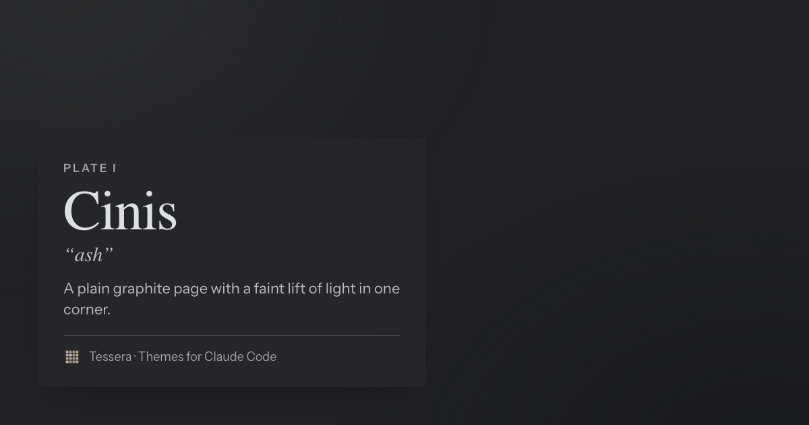</a><br><strong>I. Cinis</strong> · ash<br><sub>A plain graphite page with a faint lift of light in one corner.</sub><br><sub><em>If you like GitHub Dark or One Dark.</em></sub></td>
    <td width="33%" valign="top"><a href="https://tessera.shiptiffin.app/purpura/">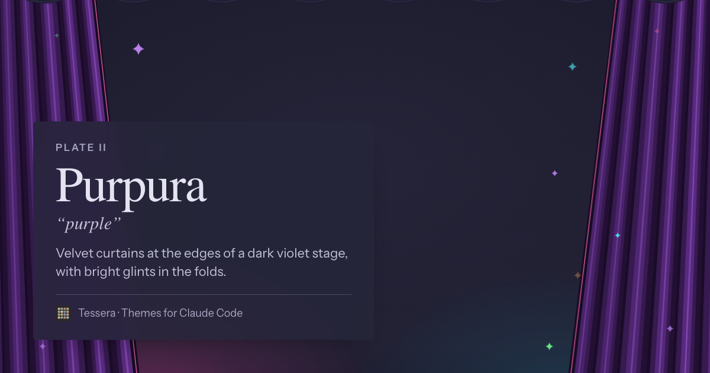</a><br><strong>II. Purpura</strong> · purple<br><sub>Velvet curtains at the edges of a dark violet stage, with bright glints in the folds.</sub><br><sub><em>If you like Dracula or Shades of Purple.</em></sub></td>
    <td width="33%" valign="top"><a href="https://tessera.shiptiffin.app/indicum/">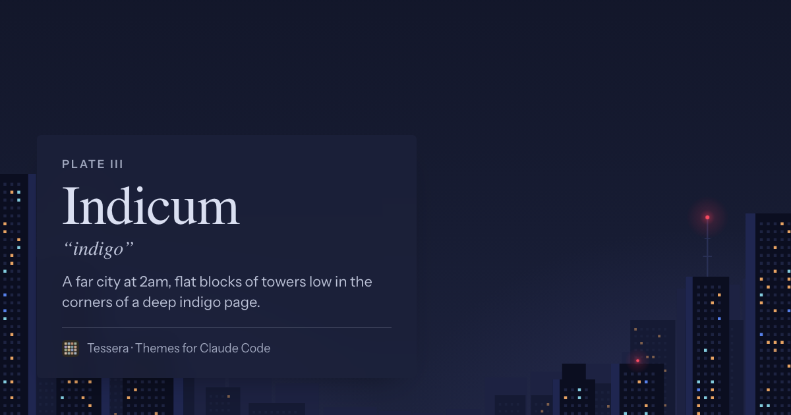</a><br><strong>III. Indicum</strong> · indigo<br><sub>A far city at 2am, flat blocks of towers low in the corners of a deep indigo page.</sub><br><sub><em>If you like Tokyo Night or Night Owl.</em></sub></td>
  </tr>
  <tr>
    <td width="33%" valign="top"><a href="https://tessera.shiptiffin.app/terra/">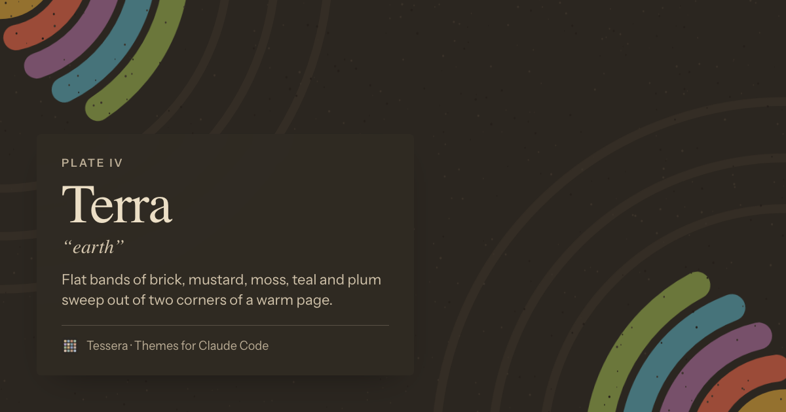</a><br><strong>IV. Terra</strong> · earth<br><sub>Flat bands of brick, mustard, moss, teal and plum sweep out of two corners of a warm page.</sub><br><sub><em>If you like Gruvbox.</em></sub></td>
    <td width="33%" valign="top"><a href="https://tessera.shiptiffin.app/dulcis/">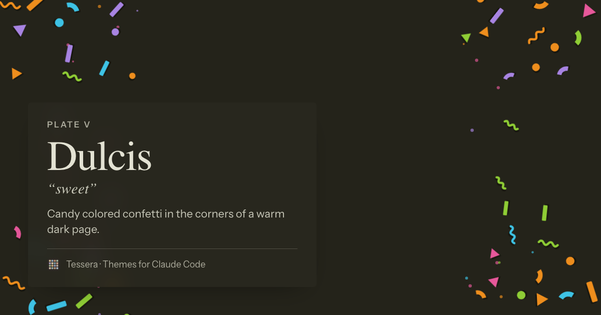</a><br><strong>V. Dulcis</strong> · sweet<br><sub>Candy colored confetti in the corners of a warm dark page.</sub><br><sub><em>If you like Monokai.</em></sub></td>
    <td width="33%" valign="top"><a href="https://tessera.shiptiffin.app/glacies/">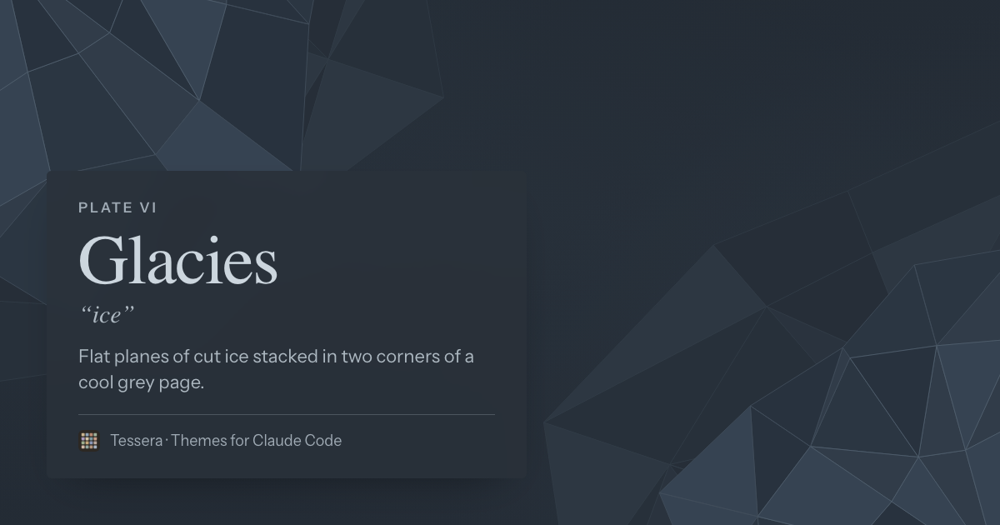</a><br><strong>VI. Glacies</strong> · ice<br><sub>Flat planes of cut ice stacked in two corners of a cool grey page.</sub><br><sub><em>If you like Nord.</em></sub></td>
  </tr>
  <tr>
    <td width="33%" valign="top"><a href="https://tessera.shiptiffin.app/sol/">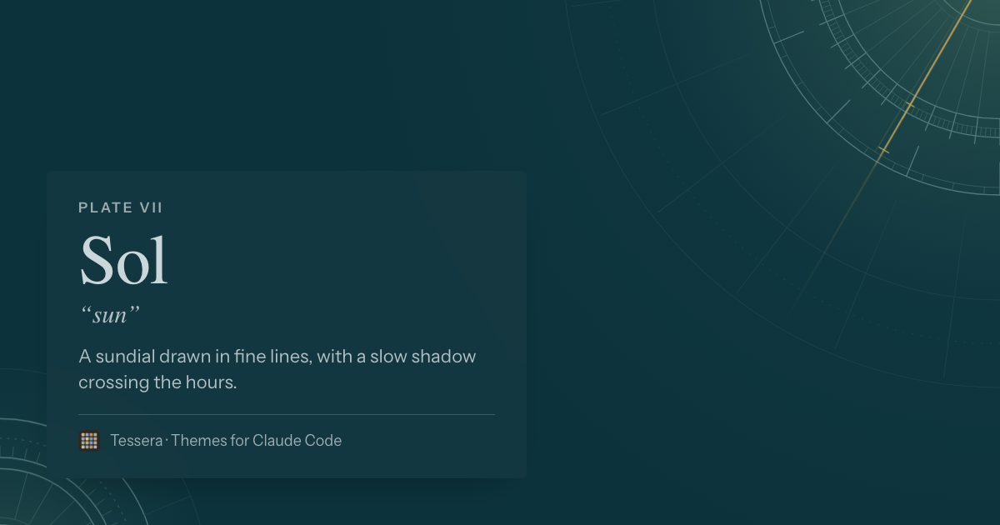</a><br><strong>VII. Sol</strong> · sun<br><sub>A sundial drawn in fine lines, with a slow shadow crossing the hours.</sub><br><sub><em>If you like Solarized.</em></sub></td>
    <td width="33%" valign="top"><a href="https://tessera.shiptiffin.app/malva/">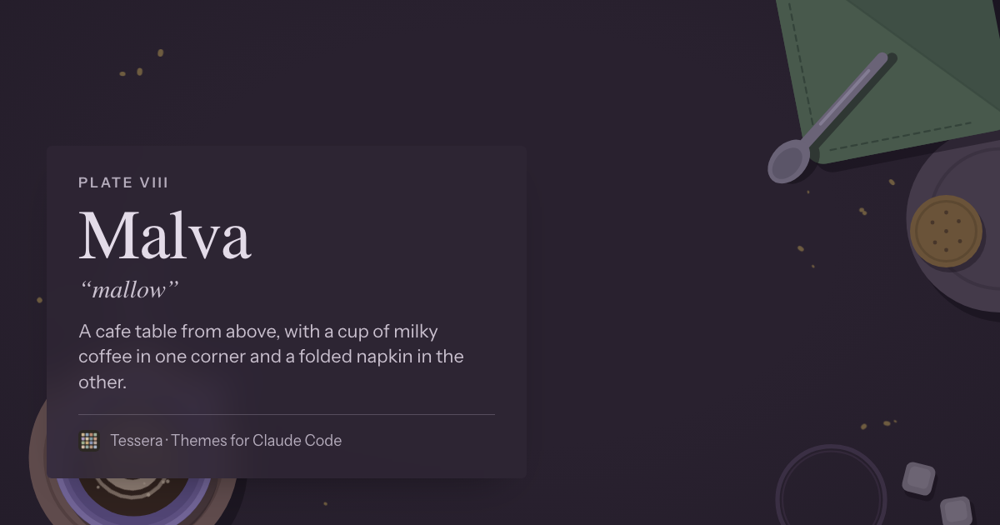</a><br><strong>VIII. Malva</strong> · mallow<br><sub>A cafe table from above, with a cup of milky coffee in one corner and a folded napkin in the other.</sub><br><sub><em>If you like Catppuccin or Rosé Pine.</em></sub></td>
    <td width="33%" valign="top"><a href="https://tessera.shiptiffin.app/atramentum/">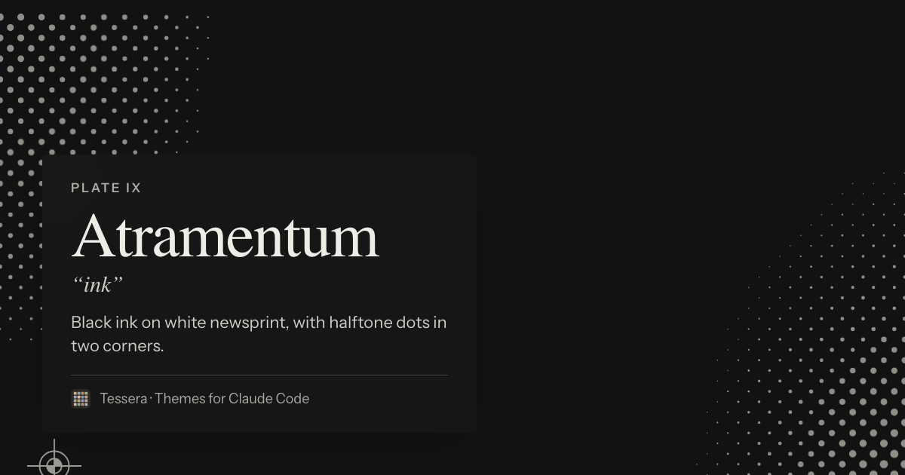</a><br><strong>IX. Atramentum</strong> · ink<br><sub>Black ink on white newsprint, with halftone dots in two corners.</sub><br><sub><em>If you like GitHub High Contrast or Modus.</em></sub></td>
  </tr>
</table>

### Bold

Graphic themes with attitude.

<table>
  <tr>
    <td width="33%" valign="top"><a href="https://tessera.shiptiffin.app/fulgur/">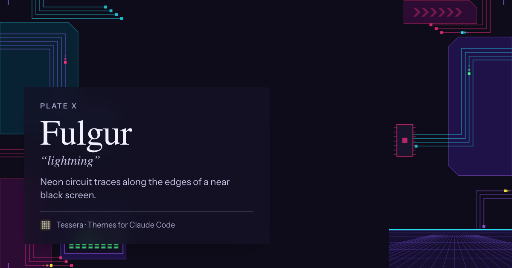</a><br><strong>X. Fulgur</strong> · lightning<br><sub>Neon circuit traces along the edges of a near black screen.</sub><br><sub><em>If you like Synthwave '84 or Cyberpunk.</em></sub></td>
    <td width="33%" valign="top"><a href="https://tessera.shiptiffin.app/caementum/">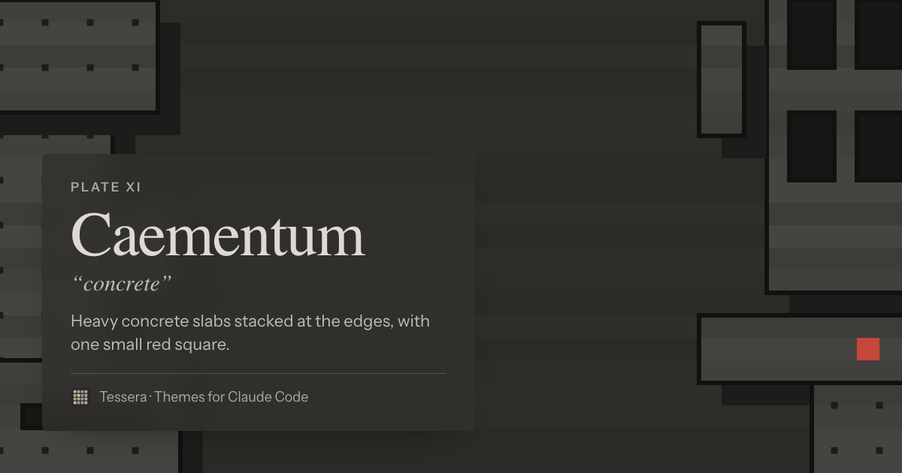</a><br><strong>XI. Caementum</strong> · concrete<br><sub>Heavy concrete slabs stacked at the edges, with one small red square.</sub></td>
    <td width="33%" valign="top"><a href="https://tessera.shiptiffin.app/forma/">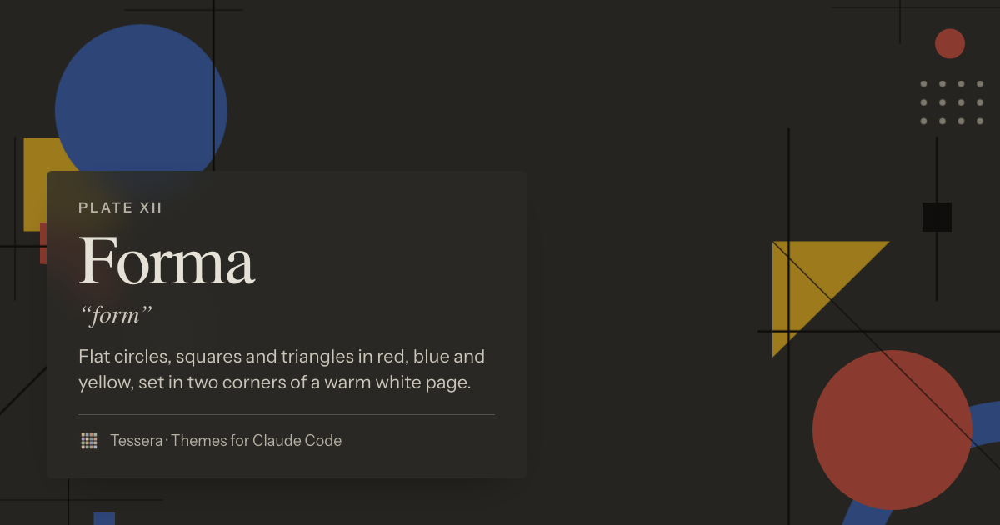</a><br><strong>XII. Forma</strong> · form<br><sub>Flat circles, squares and triangles in red, blue and yellow, set in two corners of a warm white page.</sub></td>
  </tr>
  <tr>
    <td width="33%" valign="top"><a href="https://tessera.shiptiffin.app/phosphor/">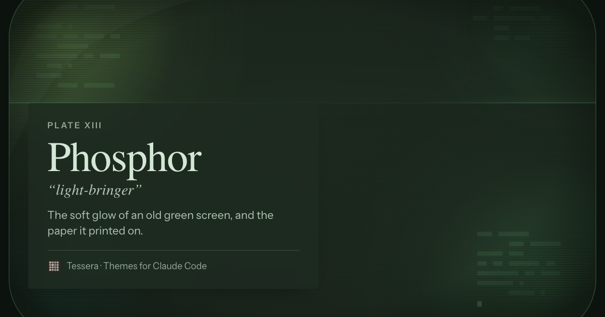</a><br><strong>XIII. Phosphor</strong> · light-bringer<br><sub>The soft glow of an old green screen, and the paper it printed on.</sub><br><sub><em>If you like classic green terminals.</em></sub></td>
    <td width="33%" valign="top"><a href="https://tessera.shiptiffin.app/machina/">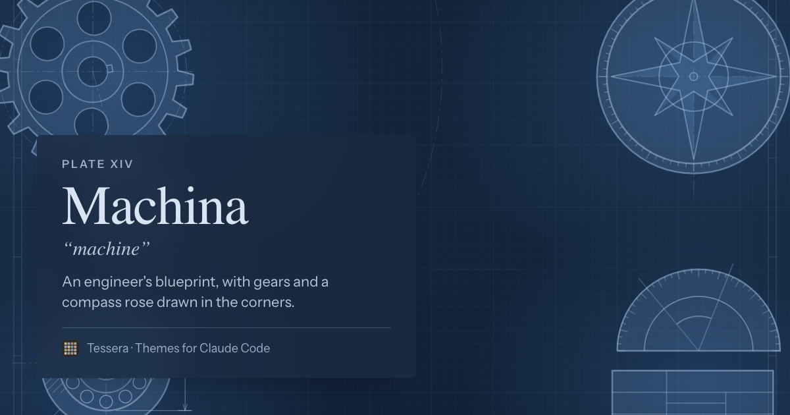</a><br><strong>XIV. Machina</strong> · machine<br><sub>An engineer's blueprint, with gears and a compass rose drawn in the corners.</sub><br><sub><em>If you like Cobalt.</em></sub></td>
    <td width="33%" valign="top"><a href="https://tessera.shiptiffin.app/aurum/"></a><br><strong>XV. Aurum</strong> · gold<br><sub>Gold fans and sunbursts in the corners of a warm black room.</sub></td>
  </tr>
</table>

### Places

Soft scenes.

<table>
  <tr>
    <td width="33%" valign="top"><a href="https://tessera.shiptiffin.app/pluvia/">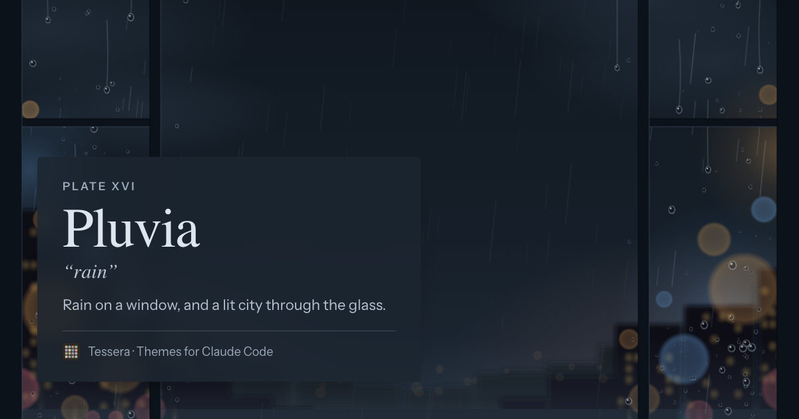</a><br><strong>XVI. Pluvia</strong> · rain<br><sub>Rain on a window, and a lit city through the glass.</sub></td>
    <td width="33%" valign="top"><a href="https://tessera.shiptiffin.app/aurora/"></a><br><strong>XVII. Aurora</strong> · dawn<br><sub>Northern lights over a snowy ridge on a long polar night.</sub><br><sub><em>If you like Nord.</em></sub></td>
    <td width="33%" valign="top"><a href="https://tessera.shiptiffin.app/abyssus/"></a><br><strong>XVIII. Abyssus</strong> · the deep<br><sub>Deep blue water, with jellyfish glowing softly at the edges.</sub></td>
  </tr>
  <tr>
    <td width="33%" valign="top"><a href="https://tessera.shiptiffin.app/nox/">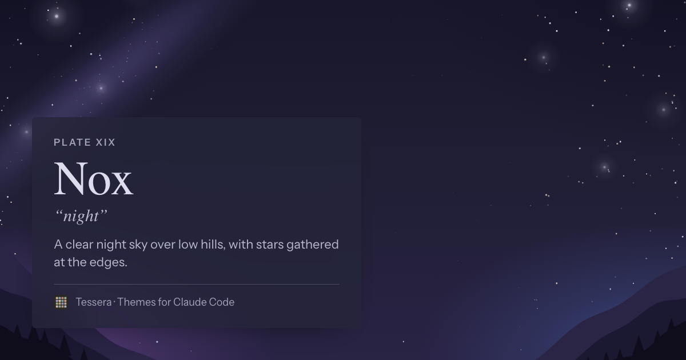</a><br><strong>XIX. Nox</strong> · night<br><sub>A clear night sky over low hills, with stars gathered at the edges.</sub></td>
    <td width="33%" valign="top"><a href="https://tessera.shiptiffin.app/vesper/">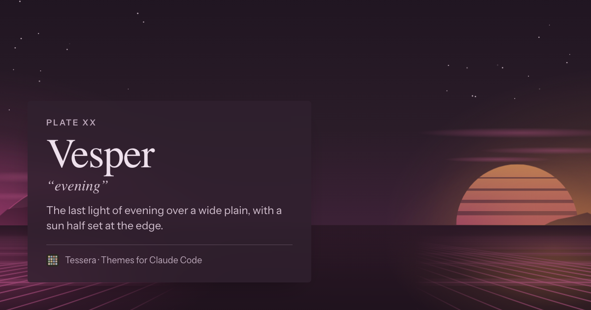</a><br><strong>XX. Vesper</strong> · evening<br><sub>The last light of evening over a wide plain, with a sun half set at the edge.</sub><br><sub><em>If you like Rosé Pine.</em></sub></td>
    <td width="33%" valign="top"><a href="https://tessera.shiptiffin.app/ignis/"></a><br><strong>XXI. Ignis</strong> · fire<br><sub>A hearth at night, with embers glowing low in the corners and sparks rising at the edges.</sub><br><sub><em>If you like Gruvbox.</em></sub></td>
  </tr>
  <tr>
    <td width="33%" valign="top"><a href="https://tessera.shiptiffin.app/silva/"></a><br><strong>XXII. Silva</strong> · forest<br><sub>Pine woods in mist, with fireflies at the edges of the trees.</sub><br><sub><em>If you like Everforest.</em></sub></td>
    <td width="33%" valign="top"><a href="https://tessera.shiptiffin.app/scriptorium/"></a><br><strong>XXIII. Scriptorium</strong> · writing room<br><sub>A vellum page with painted vines in its margins, and a candle burning low at night.</sub></td>
    <td width="33%" valign="top"><a href="https://tessera.shiptiffin.app/hortus/">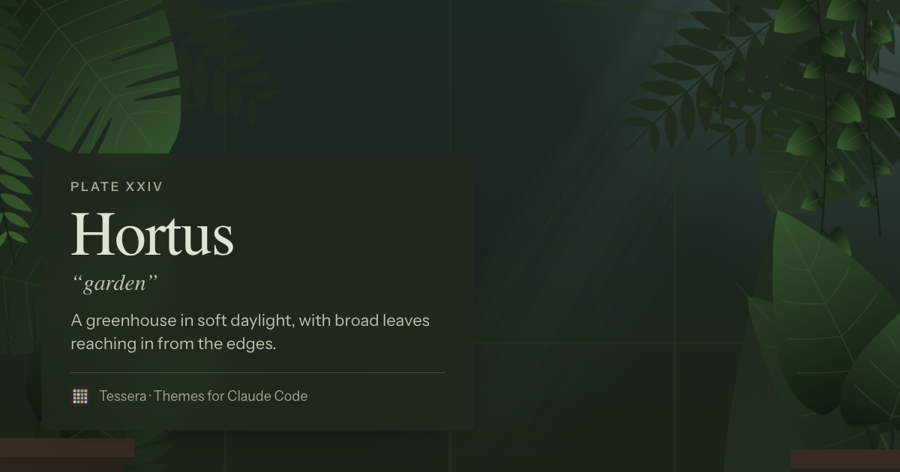</a><br><strong>XXIV. Hortus</strong> · garden<br><sub>A greenhouse in soft daylight, with broad leaves reaching in from the edges.</sub></td>
  </tr>
  <tr>
    <td width="33%" valign="top"><a href="https://tessera.shiptiffin.app/flos/"></a><br><strong>XXV. Flos</strong> · flower<br><sub>A flowering branch in spring, reaching in from the corner.</sub><br><sub><em>If you like Catppuccin.</em></sub></td>
  </tr>
</table>

<!-- plates:end -->

## Made for reading

You look at this app for hours. So every theme keeps the same floors, and a script measures them. Above the floors, each theme chooses its own character.

**Floors, for every theme**

- **Still while you read.** Motion runs only while Claude is working. A reading study found that animated backgrounds slow reading, and nobody reads while the spinner runs.
- **Text that reads without effort.** Each theme declares a contrast level and is held to its range: 7:1 to 10:1 for calm themes, 9:1 to 14:1 for most, 14:1 and up for stark ones.
- **Muted text you can read.** Tool summaries and timestamps keep at least 4.5:1, measured over the brightest and darkest point of the scene, at six moments of its animation.
- **A quiet middle.** Art keeps to the edges and corners. The column where the words sit stays plain.
- **Sound that means something.** The chime plays only after a turn of 20 seconds or more. Music is opt in, and it stops when the answer is ready.
- **Off switches.** One command stops motion. One stops sound. The system's reduced motion setting stops every scene too.

**Character, for each theme to choose**

A vibe in three words. A contrast level. Calm or vivid accents. A tint, or none. One art style, held throughout: soft illustration, flat cut paper, thin line drawing, hard slabs, halftone dots. A way of moving, or stillness. Words, a chime and a loop in its own voice.

The full list, with where each number comes from, is in [DESIGN.md](DESIGN.md).

## How it is built

A theme is three small files, plus two sounds made from its own description.

```
themes/<name>/
  theme.json    name, wing, kin, vibe, contrast level, spinner words, both sounds described
  palette.ts    six neutral colors per mode, five accents, the glass
  scene.ts      one SVG, drawn for both modes, animated with CSS
  chime.mp3     the sound after a long turn
  bed.mp3       the loop that plays while Claude works
runtime/        the hooks module every theme shares
plugins/        generated: what people install
site/           the gallery
```

| Script | What it does |
|---|---|
| `bun scripts/check.ts [name]` | Measures a theme against the design rules |
| `bun scripts/shot.ts <name> <folder>` | Takes pictures of a theme, still and moving, in both modes |
| `bun scripts/sheet.ts <folder>` | Puts every theme on one picture per mode |
| `bun scripts/chimes.ts [name]` | Makes and levels a theme's chime |
| `bun scripts/beds.ts [name]` | Makes a theme's seamless 20 second loop |
| `bun scripts/pack.ts` | Packs themes into installable plugins |
| `bun scripts/build-site.ts` | Writes the gallery's data, scenes and sounds |
| `bun scripts/readme.ts` | Rewrites the plates section of this file |

To add another, read [CONTRIBUTING.md](CONTRIBUTING.md). A theme that passes `check.ts` is welcome.

## Sponsor

Tessera is sponsored by [ShipTiffin](https://shiptiffin.app), which hosts the gallery.

## License

[MIT](LICENSE). An independent project, not affiliated with Anthropic.
