<p align="center">
  <a href="https://tessera.shiptiffin.app">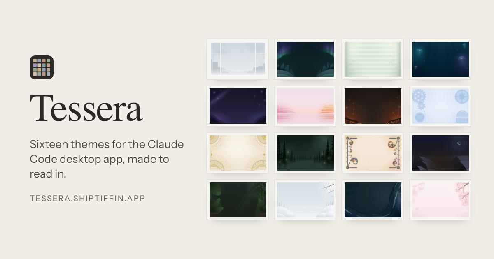</a>
</p>

<h1 align="center">Tessera</h1>

<p align="center"><strong>Rooms to read in.</strong><br>Sixteen themes for the Claude Code desktop app.</p>

<p align="center">
  <a href="https://tessera.shiptiffin.app">See the gallery</a> ·
  <a href="#install">Install</a> ·
  <a href="DESIGN.md">How they are designed</a> ·
  <a href="CONTRIBUTING.md">Add a theme</a>
</p>

---

Each theme sets the app's colors and draws a quiet scene behind the conversation. The scene moves while Claude works. When the answer lands, it holds still, so nothing moves while you read.

*Tessera* is Latin for a mosaic tile. There are sixteen, in light and dark.

## Install

One plugin holds all sixteen.

**In the desktop app.** Click **+** next to the prompt box, then **Plugins**. Add the marketplace `btahir/tessera`, then add the `tessera` plugin.

**In a terminal session.**

```
/plugin install tessera --marketplace btahir/tessera
```

**Or ask Claude.** Paste this:

```
Install the tessera plugin from the btahir/tessera marketplace on GitHub.
```

Then pick a room:

```
/tessera aurora
```

| Command | What it does |
|---|---|
| `/tessera <name>` | Switches to that theme. Your choice is kept between sessions. |
| `/tessera` | Lists the themes and shows the one in use. |
| `/tessera still` | Stops all motion for good. `/tessera move` starts it again. |
| `/tessera quiet` | Mutes the chime. `/tessera sound` brings it back. |

Want only one? Each theme is also its own plugin: `/plugin install nox --marketplace btahir/tessera`.

Themes show in the desktop and mobile apps. The terminal draws no themes. The chime plays on macOS.

## The plates

<table>
  <tr>
    <td width="25%"><a href="https://tessera.shiptiffin.app/pluvia/"></a><br><strong>I. Pluvia</strong> · rain<br><sub>Rain on a window, and a lit city through the glass.</sub></td>
    <td width="25%"><a href="https://tessera.shiptiffin.app/aurora/">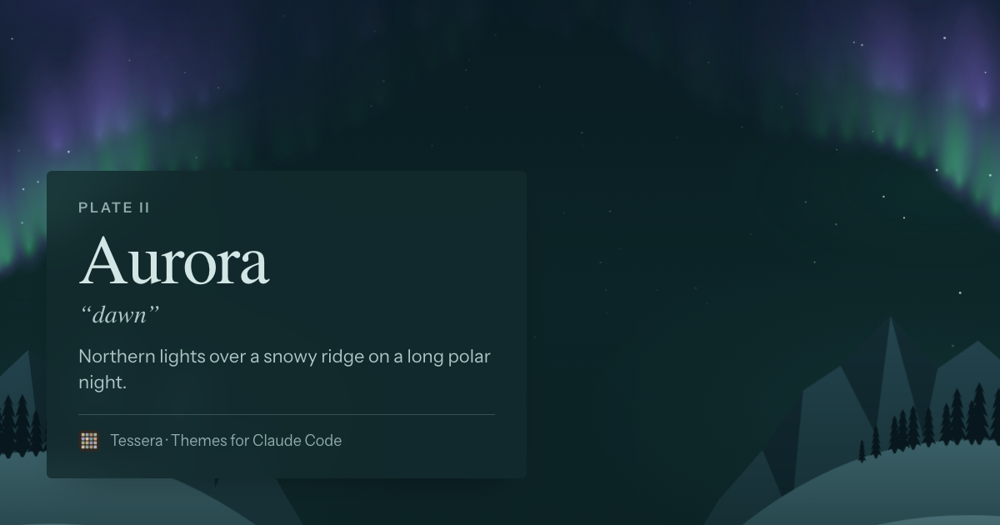</a><br><strong>II. Aurora</strong> · dawn<br><sub>Northern lights over a snowy ridge on a long polar night.</sub></td>
    <td width="25%"><a href="https://tessera.shiptiffin.app/phosphor/"></a><br><strong>III. Phosphor</strong> · light-bringer<br><sub>The soft glow of an old green screen, and the paper it printed on.</sub></td>
    <td width="25%"><a href="https://tessera.shiptiffin.app/abyssus/">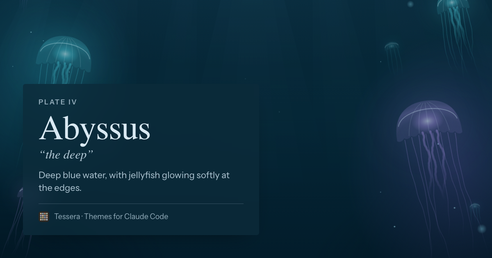</a><br><strong>IV. Abyssus</strong> · the deep<br><sub>Deep blue water, with jellyfish glowing softly at the edges.</sub></td>
  </tr>
  <tr>
    <td><a href="https://tessera.shiptiffin.app/nox/"></a><br><strong>V. Nox</strong> · night<br><sub>A clear night sky over low hills, with stars gathered at the edges.</sub></td>
    <td><a href="https://tessera.shiptiffin.app/vesper/"></a><br><strong>VI. Vesper</strong> · evening<br><sub>The last light of evening over a wide plain, with a sun half set at the edge.</sub></td>
    <td><a href="https://tessera.shiptiffin.app/ignis/">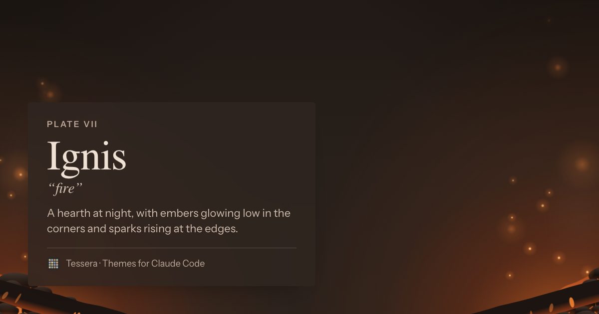</a><br><strong>VII. Ignis</strong> · fire<br><sub>A hearth at night, with embers glowing low in the corners and sparks rising at the edges.</sub></td>
    <td><a href="https://tessera.shiptiffin.app/machina/"></a><br><strong>VIII. Machina</strong> · machine<br><sub>An engineer's blueprint, with gears and a compass rose drawn in the corners.</sub></td>
  </tr>
  <tr>
    <td><a href="https://tessera.shiptiffin.app/aurum/">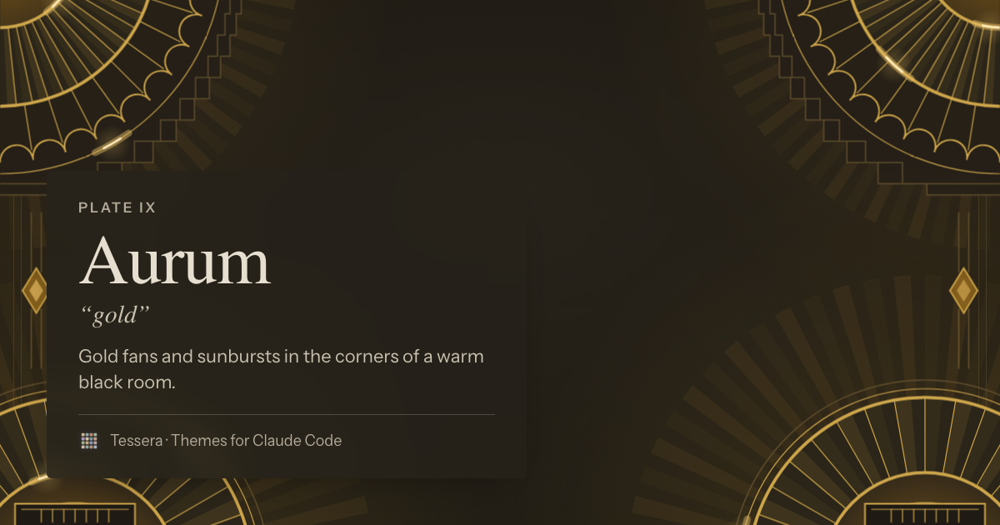</a><br><strong>IX. Aurum</strong> · gold<br><sub>Gold fans and sunbursts in the corners of a warm black room.</sub></td>
    <td><a href="https://tessera.shiptiffin.app/silva/">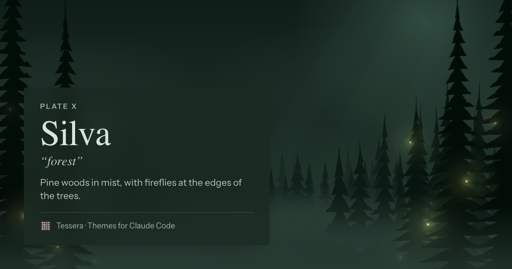</a><br><strong>X. Silva</strong> · forest<br><sub>Pine woods in mist, with fireflies at the edges of the trees.</sub></td>
    <td><a href="https://tessera.shiptiffin.app/scriptorium/">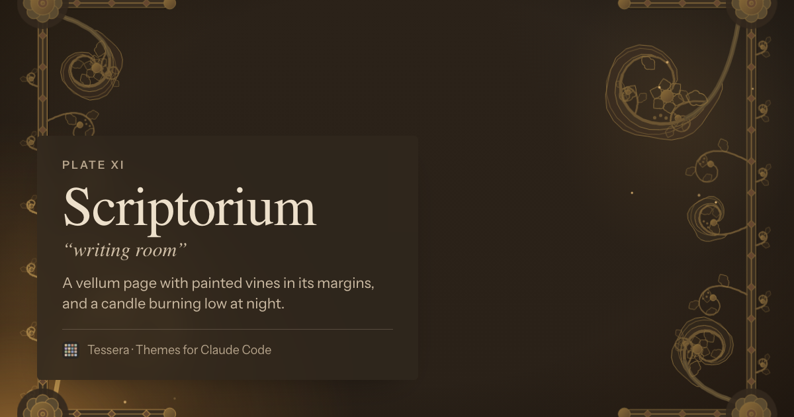</a><br><strong>XI. Scriptorium</strong> · writing room<br><sub>A vellum page with painted vines in its margins, and a candle burning low at night.</sub></td>
    <td><a href="https://tessera.shiptiffin.app/meridies/">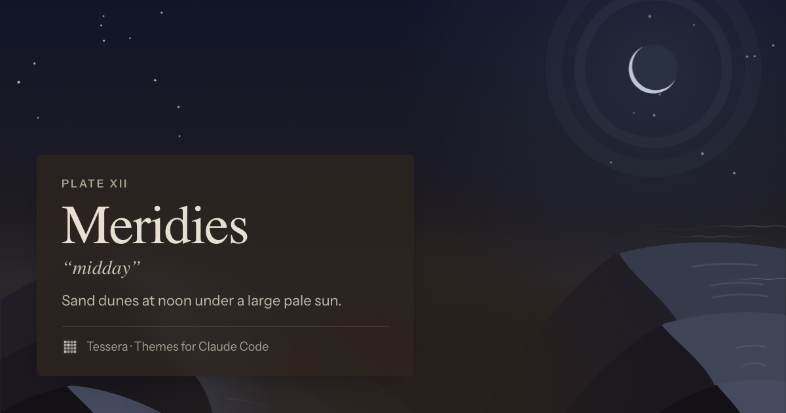</a><br><strong>XII. Meridies</strong> · midday<br><sub>Sand dunes at noon under a large pale sun.</sub></td>
  </tr>
  <tr>
    <td><a href="https://tessera.shiptiffin.app/hortus/"></a><br><strong>XIII. Hortus</strong> · garden<br><sub>A greenhouse in soft daylight, with broad leaves reaching in from the edges.</sub></td>
    <td><a href="https://tessera.shiptiffin.app/nix/">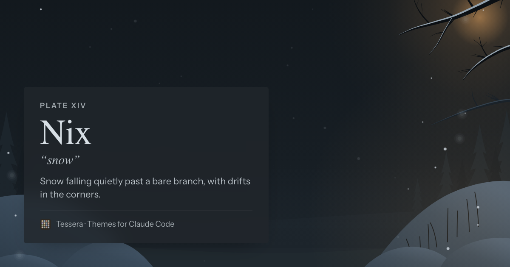</a><br><strong>XIV. Nix</strong> · snow<br><sub>Snow falling quietly past a bare branch, with drifts in the corners.</sub></td>
    <td><a href="https://tessera.shiptiffin.app/mare/">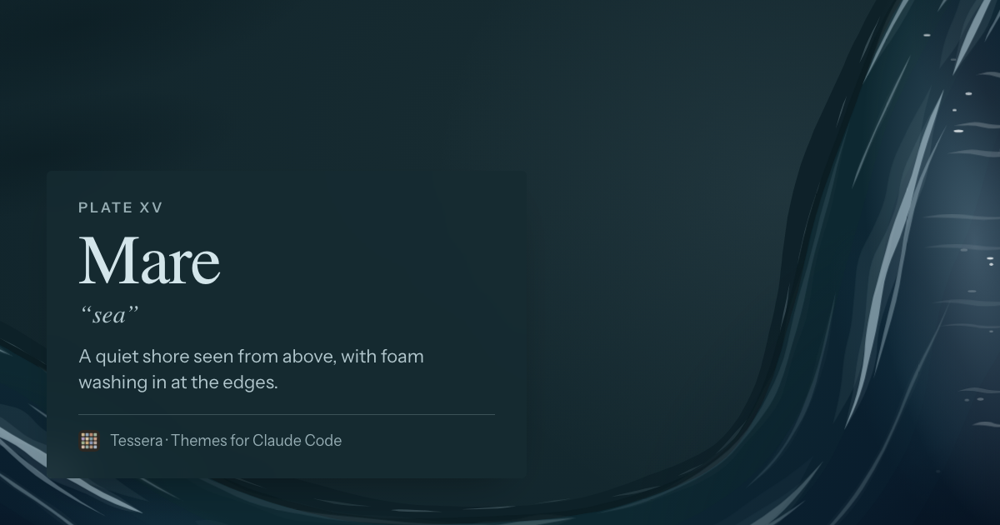</a><br><strong>XV. Mare</strong> · sea<br><sub>A quiet shore seen from above, with foam washing in at the edges.</sub></td>
    <td><a href="https://tessera.shiptiffin.app/flos/">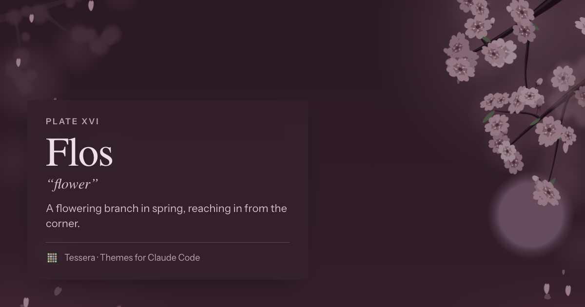</a><br><strong>XVI. Flos</strong> · flower<br><sub>A flowering branch in spring, reaching in from the corner.</sub></td>
  </tr>
</table>

## Made for reading

You look at this app for hours. So every theme is held to the same 22 rules, and a script measures them.

- **Still while you read.** Motion runs only while Claude is working. A reading study found that animated backgrounds slow reading, and nobody reads while the spinner runs.
- **No black, no white.** Dark pages sit near 0.25 lightness and light pages near 0.95, each with a slight tint. Popular terminal themes sit in the same range.
- **Body text between 9:1 and 14:1.** Enough contrast to read without effort, and not so much that it glares.
- **Muted text you can read.** Tool summaries and timestamps keep at least 4.5:1, measured over the brightest and darkest point of the scene, at six moments of its animation.
- **A quiet middle.** Detail and motion keep to the edges and corners. The column where the words sit holds only soft gradients.
- **A chime that means something.** It plays only after a turn of 20 seconds or more, when you may have looked away.
- **Off switches.** One command stops motion. One mutes sound. The system's reduced motion setting stops every scene too.

The full list, with where each number comes from, is in [DESIGN.md](DESIGN.md).

## How it is built

A theme is three small files: colors, one SVG scene, and a few words.

```
themes/<name>/
  theme.json    name, meaning, tagline, spinner words, the chime's description
  palette.ts    six neutral colors per mode, five accents, the glass
  scene.ts      one SVG, drawn for both modes, animated with CSS
  chime.mp3     the sound after a long turn
runtime/        the hooks module every theme shares
plugins/        generated: what people install
site/           the gallery
```

| Script | What it does |
|---|---|
| `bun scripts/check.ts [name]` | Measures a theme against the design rules |
| `bun scripts/shot.ts <name> <folder>` | Takes pictures of a theme, still and moving, in both modes |
| `bun scripts/sheet.ts <folder>` | Puts all sixteen on one picture per mode |
| `bun scripts/chimes.ts [name]` | Makes and levels a theme's chime |
| `bun scripts/pack.ts` | Packs themes into installable plugins |
| `bun scripts/build-site.ts` | Writes the gallery's data, scenes and sounds |

To add a seventeenth, read [CONTRIBUTING.md](CONTRIBUTING.md). A theme that passes `check.ts` is welcome.

## Sponsor

Tessera is sponsored by [ShipTiffin](https://shiptiffin.app), which hosts the gallery.

## License

[MIT](LICENSE). An independent project, not affiliated with Anthropic.
